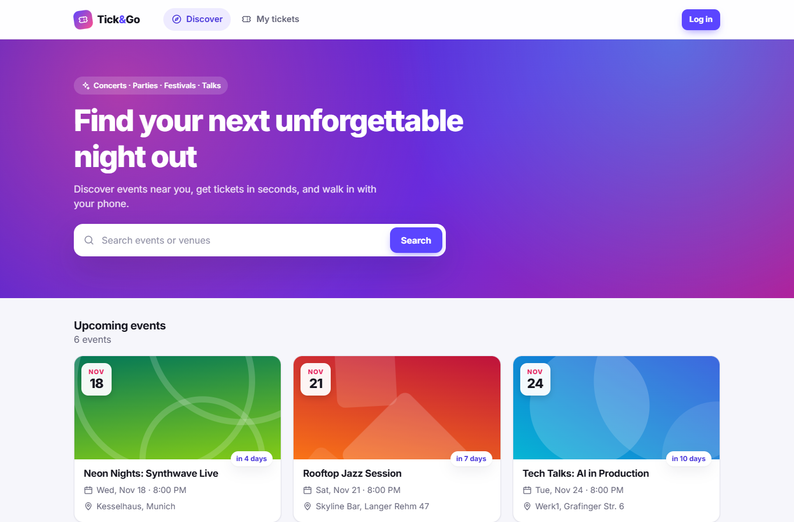
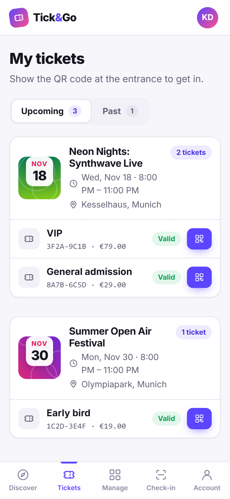
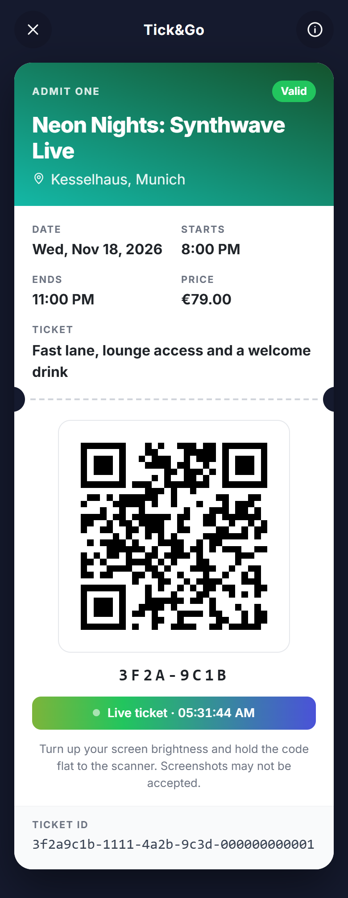
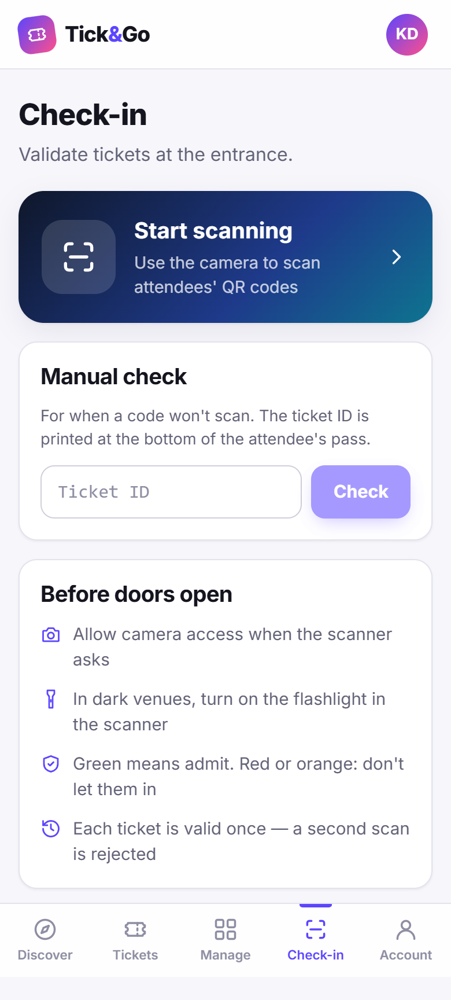
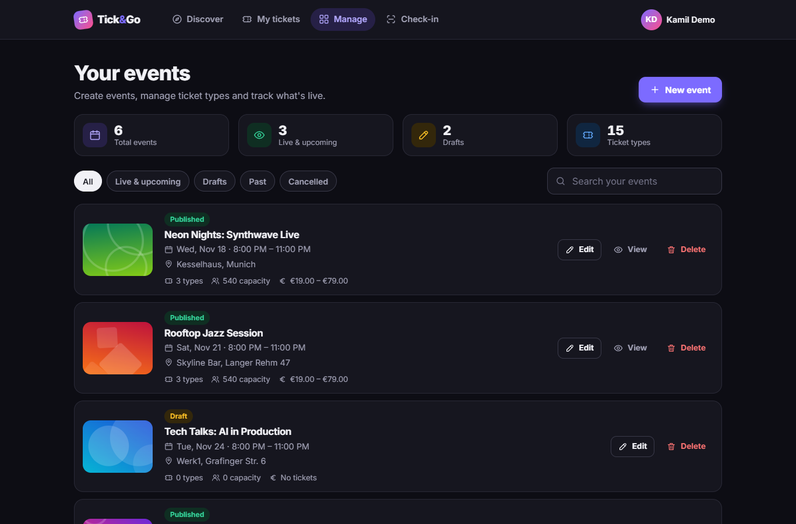
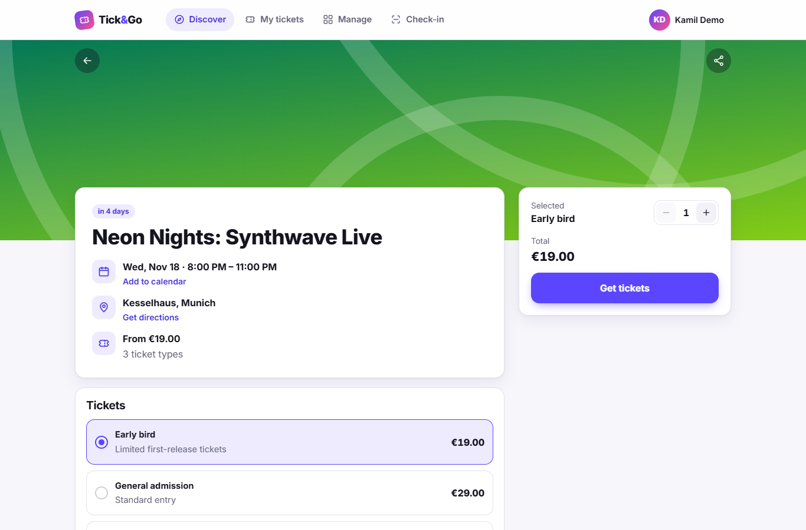
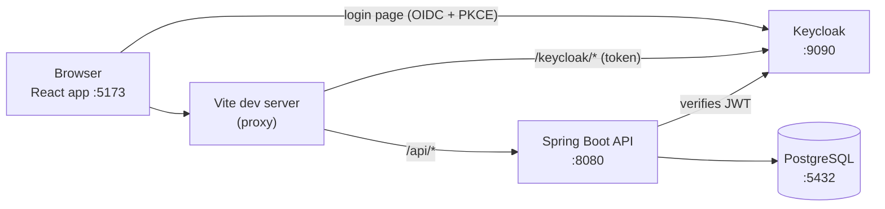

# Tick&Go 🎟️

**Tick&Go** is a full-stack event ticketing platform. Organizers create events and sell tickets,
attendees discover events and buy tickets that live on their phone as a QR code, and staff scan
those codes at the entrance.

It's built with **Spring Boot 4** (Java 21) on the backend, **React 19 + TypeScript** on the frontend, **PostgreSQL**
for data and **Keycloak** for login and roles.

<p>
  
</p>

<p>
  
  
  
</p>

---

## Contents

- [Features](#features)
- [How it works](#how-it-works)
- [Tech stack](#tech-stack)
- [Getting started](#getting-started)
    - [1. Prerequisites](#1-prerequisites)
    - [2. Start PostgreSQL and Keycloak](#2-start-postgresql-and-keycloak)
    - [3. Configure Keycloak](#3-configure-keycloak)
    - [4. Run the backend](#4-run-the-backend)
    - [5. Run the frontend](#5-run-the-frontend)
- [Trying it out](#trying-it-out)
- [REST API](#rest-api)
- [Project structure](#project-structure)
- [Troubleshooting](#troubleshooting)

---

## Features

The app has three kinds of users. What you see depends on your role.

### 🎉 Attendee (every logged-in user)

- **Discover** published events, with search over name and venue (no login needed)
- **Event page** with date, venue, directions, *add to calendar* and share
- **Buy tickets**: choose a ticket type and quantity, confirm, done
- **My tickets**, grouped per event, upcoming and past
- **Mobile pass** with the entry QR code, a live clock against screenshots, and the screen kept awake

### 🗂️ Organizer (`ROLE_ORGANIZER`)

- **Dashboard** with stats, filters (live, drafts, past, cancelled) and search
- **Create, edit and delete events**: name, venue, dates, ticket sales window, status
- **Ticket types** with price (EUR), optional quantity limit and description
- Events become visible to attendees once they are **Published**



### 📷 Staff (`ROLE_STAFF`)

- **Camera QR scanner** with a full-screen green or red result, sound, vibration, flashlight and camera switch
- **Manual check** by ticket ID, for when a code won't scan
- A ticket is admitted **once**: the second scan is rejected, and tickets for events that are over count as expired

### Everywhere

- Mobile-first design with a bottom tab bar on phones and a top navigation bar on desktop
- Light and dark mode (follows the system, or pick one under *Account*)



---

## How it works



1. **Login:** the frontend sends users to the Keycloak login page using OpenID Connect (Authorization Code + PKCE) and
   gets back an access token (JWT).
2. **API calls:** every request to the backend carries that token. Spring Security checks it against
   Keycloak and reads the user's realm roles from `realm_access.roles`.
3. **Users** are created in the database automatically the first time they call the API (`UserProvisioningFilter`).
4. **Buying a ticket** creates a ticket and a QR code. The QR code contains a random ID, not the
   ticket ID.
5. **Checking in:** staff scan that QR code. The backend records every attempt, marks the ticket as
   used on the first valid scan, and rejects later scans, cancelled tickets and events that are over.

The Vite dev server proxies `/api` to the backend and the Keycloak token endpoint to Keycloak,
so the browser never makes cross-origin calls and no CORS setup is needed.

---

## Tech stack

| Layer           | Technology                                                                                 |
|-----------------|--------------------------------------------------------------------------------------------|
| Backend         | Java 21, Spring Boot 4.1 (Web MVC, Data JPA, Security, OAuth2 Resource Server, Validation) |
| Mapping & utils | MapStruct, Lombok, ZXing (QR code generation)                                              |
| Database        | PostgreSQL (schema created by Hibernate), Adminer as a DB UI                               |
| Auth            | Keycloak (OpenID Connect, realm roles)                                                     |
| Frontend        | React 19, TypeScript, Vite 6, React Router 7, react-oidc-context, jsQR (scanner)           |
| Infrastructure  | Docker Compose                                                                             |

---

## Getting started

### 1. Prerequisites

- **Java 21** (JDK)
- **Node.js 20+** and npm
- **Docker** with Docker Compose

Maven doesn't need to be installed; the project ships the Maven wrapper (`mvnw` / `mvnw.cmd`).

### 2. Start PostgreSQL and Keycloak

From the repository root:

```sh
docker compose up -d
```

This starts:

| Service         | URL                   | Login                                              |
|-----------------|-----------------------|----------------------------------------------------|
| PostgreSQL      | `localhost:5432`      | `devuser` / `devpassword`                          |
| Adminer (DB UI) | http://localhost:8888 | system *PostgreSQL*, server `db`, same credentials |
| Keycloak        | http://localhost:9090 | `admin` / `admin`                                  |

> These are development credentials. Don't use them anywhere public.

### 3. Configure Keycloak

You only do this once; Keycloak keeps its data in a Docker volume.
Open http://localhost:9090 and log in as `admin` / `admin`.

1. **Create a realm** named `event-ticket-platform`.
2. **Create a client** (*Clients → Create client*):
    - Client ID: `event-ticket-platform-app`
    - Client authentication: **Off** (it's a public client; the browser can't keep a secret)
    - Authentication flow: **Standard flow** on
    - Valid redirect URIs: `http://localhost:5173/callback`
3. **Create two realm roles** (*Realm roles → Create role*). The names must be exact:
    - `ROLE_ORGANIZER`
    - `ROLE_STAFF`
4. **Create users** (*Users → Add user*). On the *Credentials* tab, set a password with *Temporary* turned off. Then
   give them roles (*Role mapping → Assign role*):

   | Example user | Roles            | Can do                               |
   |--------------|------------------|--------------------------------------|
   | `attendee`   | none             | Browse, buy tickets, show QR codes   |
   | `organizer`  | `ROLE_ORGANIZER` | Everything above, plus manage events |
   | `staff`      | `ROLE_STAFF`     | Everything above, plus scan tickets  |

   One user can have both roles.

The backend expects tokens from `http://localhost:9090/realms/event-ticket-platform`
(see `src/main/resources/application.properties`).

### 4. Run the backend

From the repository root:

```sh
# macOS / Linux
./mvnw spring-boot:run

# Windows
mvnw.cmd spring-boot:run
```

The API runs on http://localhost:8080. Tables are created automatically on first start.

### 5. Run the frontend

In a second terminal:

```sh
cd frontend
npm install
npm run dev
```

Open **http://localhost:5173**. 🎉

---

## Trying it out

1. Log in as **organizer**. Open **Manage → New event**, add a couple of ticket types, set the status
   to **Published** and save.
2. Log in as **attendee**. Find the event on **Discover**, choose a ticket and buy it. Open **My tickets → Show QR**.
3. Log in as **staff** on another device or browser. Open **Check-in → Start scanning** and point the
   camera at the QR code: green means admit. Scan it again and it turns red.

> The browser only allows the camera on `http://localhost` or HTTPS. To try the scanner on a PC,
> open the attendee's pass on your phone and hold it up to the webcam, or use **From photo** with a
> picture of the code.

---

## REST API

All endpoints are under `/api/v1` and expect `Authorization: Bearer <access token>`, except the
public ones.

| Method   | Endpoint                                                | Access    | Description                                                                                        |
|----------|---------------------------------------------------------|-----------|----------------------------------------------------------------------------------------------------|
| `GET`    | `/published-events?q=&page=&size=`                      | public    | List published events (full-text search with `q`)                                                  |
| `GET`    | `/published-events/{eventId}`                           | public    | Published event with its ticket types                                                              |
| `POST`   | `/events`                                               | organizer | Create an event with ticket types                                                                  |
| `GET`    | `/events?page=&size=&sort=`                             | organizer | The organizer's own events                                                                         |
| `GET`    | `/events/{eventId}`                                     | organizer | Event details                                                                                      |
| `PUT`    | `/events/{eventId}`                                     | organizer | Update an event (ticket types with an `id` are updated, without one created, missing ones deleted) |
| `DELETE` | `/events/{eventId}`                                     | organizer | Delete an event                                                                                    |
| `POST`   | `/events/{eventId}/ticket-types/{ticketTypeId}/tickets` | logged in | Buy one ticket                                                                                     |
| `GET`    | `/tickets?page=&size=`                                  | logged in | The user's tickets                                                                                 |
| `GET`    | `/tickets/{ticketId}`                                   | logged in | One of the user's tickets                                                                          |
| `GET`    | `/tickets/{ticketId}/qr-codes`                          | logged in | The ticket's QR code (PNG)                                                                         |
| `POST`   | `/ticket-validations`                                   | staff     | Check a ticket in: `{"id": "...", "method": "QR_SCAN" or "MANUAL"}`                                |

Errors come back as `{"error": "message"}`.

---

## Project structure

```
tickandgo/
├── docker-compose.yml        PostgreSQL, Adminer, Keycloak
├── pom.xml                   Backend build (Maven)
├── src/main/java/com/kmlynk/tickandgo/
│   ├── config/               Security (roles from Keycloak), JPA, QR code writer
│   ├── controllers/          REST endpoints and global error handling
│   ├── domain/               Entities, DTOs and request objects
│   ├── filters/              Creates users on their first request
│   ├── mappers/              MapStruct mappers (entity ↔ DTO)
│   ├── repositories/         Spring Data JPA repositories
│   ├── services/             Business logic (events, purchases, QR codes, validation)
│   └── util/                 JWT helpers
├── src/main/resources/
│   └── application.properties
├── frontend/                 React app (see frontend/README.md)
│   ├── src/lib/              API client, auth, types, formatting
│   ├── src/components/       Layout, navigation, shared UI
│   └── src/pages/            attendee/, organizer/, staff/ pages
└── docs/screenshots/         Images used in this README
```

---

## Troubleshooting

| Problem                                                       | Fix                                                                                                                           |
|---------------------------------------------------------------|-------------------------------------------------------------------------------------------------------------------------------|
| Login fails with *Invalid redirect uri*                       | The Keycloak client needs `http://localhost:5173/callback` under **Valid redirect URIs**.                                     |
| Logged in, but no *Manage* or *Check-in* tab                  | The user needs the realm role `ROLE_ORGANIZER` or `ROLE_STAFF`. Log out and back in afterwards so the new token has the role. |
| API calls answer `401`                                        | The backend isn't reaching Keycloak, or the realm name differs from `event-ticket-platform`.                                  |
| API calls answer `403`                                        | The user is logged in but lacks the role for that endpoint.                                                                   |
| After logout you stay on Keycloak's *You are logged out* page | That's expected (no post-logout redirect is configured). Open http://localhost:5173 again.                                    |
| The scanner shows *Camera unavailable*                        | Allow camera access for the site, and use `http://localhost` or HTTPS.                                                        |
| Port already in use                                           | Something else uses 5173, 8080, 9090, 5432 or 8888. Stop it or change the port mapping in `docker-compose.yml`.               |
